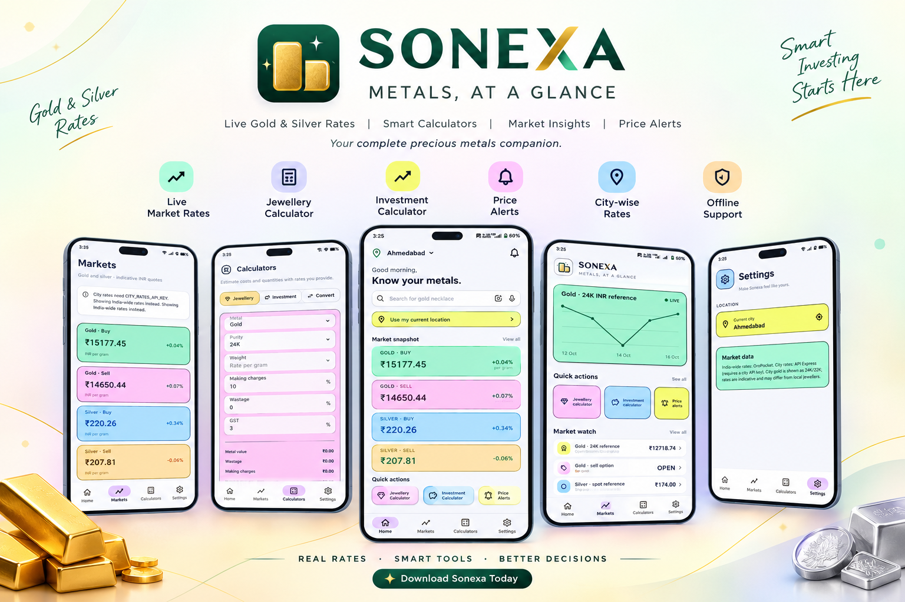
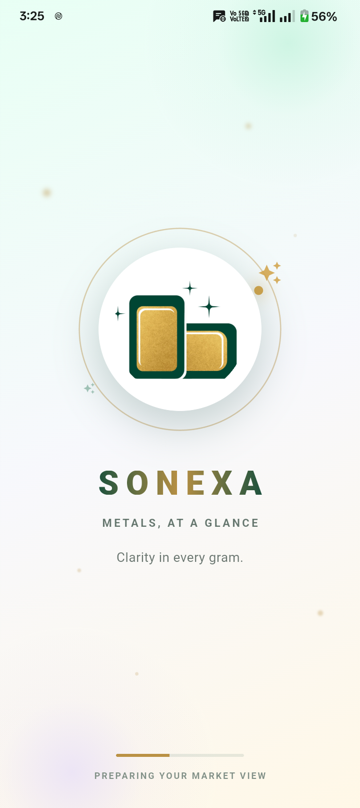
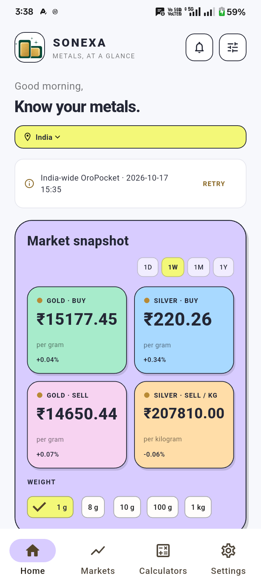
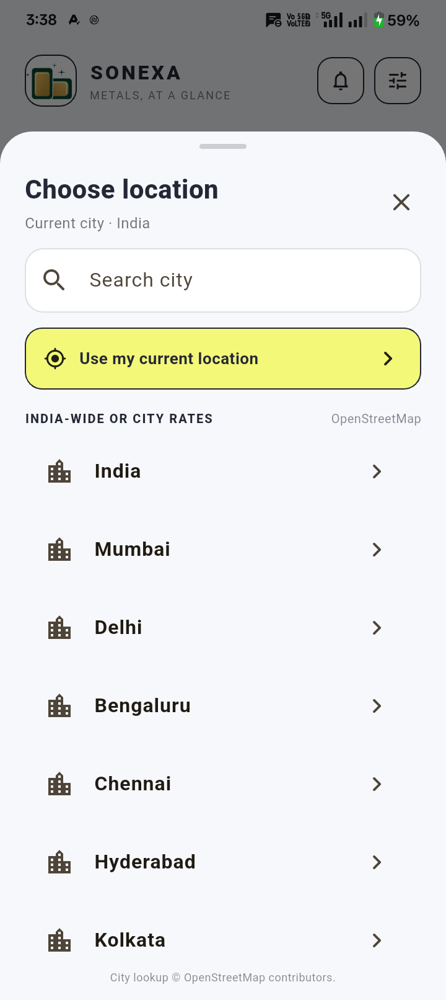
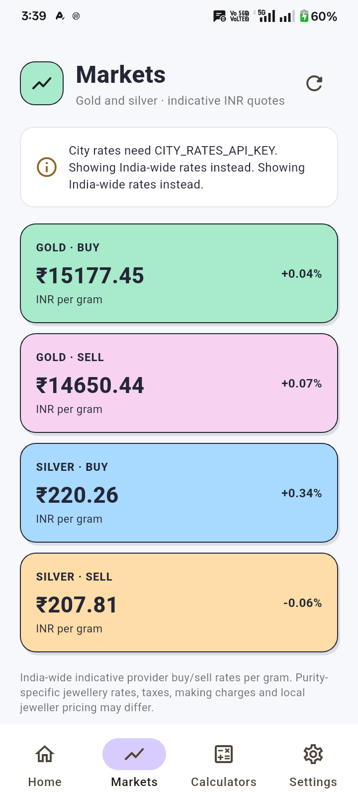
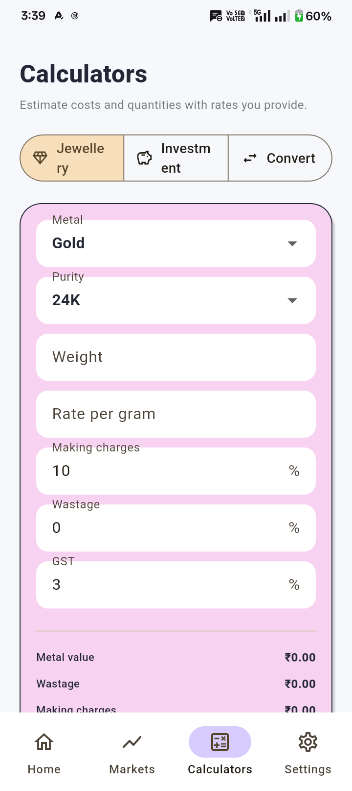
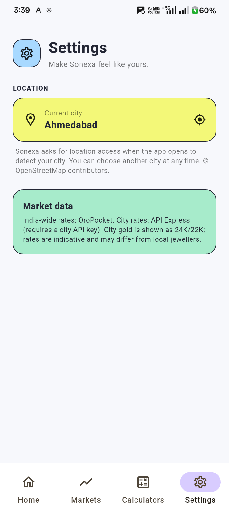
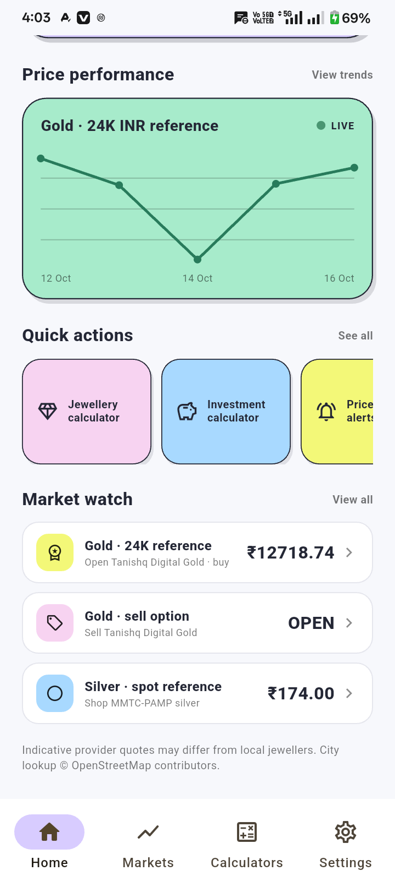
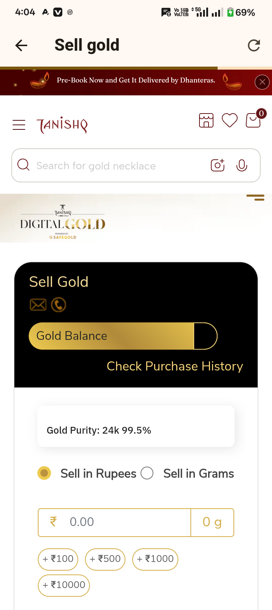

<p align="center">
  
</p>

<h1 align="center">Sonexa</h1>

<p align="center"><strong>Gold and silver reference rates, useful calculators, and market history in one Flutter app.</strong></p>

<br />

## Overview

Sonexa is a mobile precious-metals companion focused on clear INR-per-gram reference prices. Its home dashboard combines gold and silver rates, a daily gold chart, location selection, and links to selected buy and sell services. The app also includes market details, jewellery and investment estimates, a metal-purity converter, local price caching, and settings.

> Prices are indicative market references. They are not offers from a local jeweller and may not include local premiums, taxes, making charges, or resale deductions.

## Features

### Home dashboard

- Shows 24K and 22K gold references and a silver spot reference in INR.
- Provides weight choices for viewing calculated amounts, including grams and kilograms.
- Plots daily gold history with selectable `1D`, `1W`, `1M`, and `30D` ranges.
- Shows recent cached prices when the network is unavailable and provides refresh/retry controls.
- Includes quick-action cards and a Market watch list.

### Markets

- Displays gold and silver reference values with the provider's available change data.
- Labels the quotes as indicative and explains that local dealer pricing can differ.
- Refreshes market prices on demand.

### Calculators

- **Jewellery estimate:** enter metal, purity, weight, rate, making charges, wastage, and GST to estimate a total.
- **Investment estimate:** enter an investment amount, purchase rate, and current rate to estimate quantity, value, profit or loss, and return.
- **Purity converter:** convert entered gold weight to its pure-metal equivalent for 24K, 22K, or 18K.

### Location

- Starts with India-wide rates and lets users choose India or search for a city.
- Can use device location when permission is granted.
- Uses OpenStreetMap Nominatim for city search and reverse geocoding; attribution is shown in the app.
- City selection currently changes the selected location only. GoldPrice.dev's free feed does not return city-specific jewellery rates or local premiums, so rates remain India-wide.

### Market watch links

- Opens Tanishq Digital Gold pages in an in-app WebView for gold buying and selling.
- Opens the MMTC-PAMP shop for silver.
- These are links to third-party services; their products, eligibility, login requirements, and availability are controlled by those providers.

### Settings and offline support

- Shows the selected location and offers access to location selection/current location.
- Saves the latest successful market-price snapshot locally and can display it when a refresh fails.
- Marks saved prices as stale after 15 minutes.

## Screenshots

| Splash | Home dashboard |
|:---:|:---:|
|  |  |

| Location picker | Markets |
|:---:|:---:|
|  |  |

| Calculators | Settings |
|:---:|:---:|
|  |  |

| Price chart and Market watch | Gold sell WebView |
|:---:|:---:|
|  |  |

## Market data

Sonexa uses [GoldPrice.dev](https://goldprice.dev/docs/api-reference) for keyless/free-tier reference data:

| Data | Endpoint | App use |
|---|---|---|
| Gold by karat | `/v1/carat?currency=INR` | 24K and 22K INR per gram |
| Silver conversion | `/v1/convert?from=XAG&to=INR&amount=1&unit=gram` | Silver INR per gram |
| Gold history | `/v1/bars?symbol=XAU-USD-SPOT&interval=1d` | Daily chart bars, converted to an INR-per-gram reference |
| Gold spot | `/v1/spot/XAU-USD-SPOT` | Current XAU/USD reference used for chart conversion |

The free feed may be delayed by up to 15 minutes and provides up to 30 days of daily history. It does not provide intraday chart data or city-specific retail premiums. The `1D` chart range therefore uses daily provider data rather than minute-by-minute prices.

An optional GoldPrice.dev API key can be supplied at build/run time. A local `api_keys.local.json` is ignored by Git and should contain:

```json
{
  "GOLDPRICE_API_KEY": "YOUR_GOLDPRICE_API_KEY"
}
```

Keys passed through `--dart-define-from-file` are embedded in the mobile application and can be extracted from a built app. Use a backend proxy for production secrets or sensitive API quotas.

## Run locally

Install Flutter with a Dart SDK compatible with the constraint in `pubspec.yaml`, then run:

```sh
flutter pub get
flutter run --dart-define-from-file=api_keys.local.json
```

The API key is optional for free-tier endpoints. To run without the local key file:

```sh
flutter run
```

On Windows PowerShell, `.\run_with_api_key.ps1` runs the configured command and accepts additional `flutter run` arguments. To build an Android APK with the local key configuration:

```sh
flutter build apk --dart-define-from-file=api_keys.local.json
```

The Android app declares Internet access and requests location permission only for location features. A user can still select a city manually if location permission is declined.

## Project structure

```text
lib/
├── app/                 App shell, splash screen, and theme
├── core/                Shared widgets, local market cache, and utilities
└── features/
    ├── calculators/     Jewellery, investment, and purity calculations
    ├── home/            Dashboard, chart, and Market watch
    ├── location/        City search and device-location handling
    └── markets/         Market models, API service, repository, and views

assets/
├── sonexa_banner.png   README/app brand banner
├── sonexa_appicon.jpg  App icon artwork
└── 1.png–8.png         App screenshots shown above
```

## Current scope

- Prices and chart values are references, not tradeable quotes.
- City-specific retail pricing is not available from the configured free feed.
- The Home quick-action cards and price-alert entry are presentation/placeholder actions; the calculator tools are available from the Calculators tab.
- The app does not place trades or process payments. Third-party WebViews are for browsing their providers' pages.
